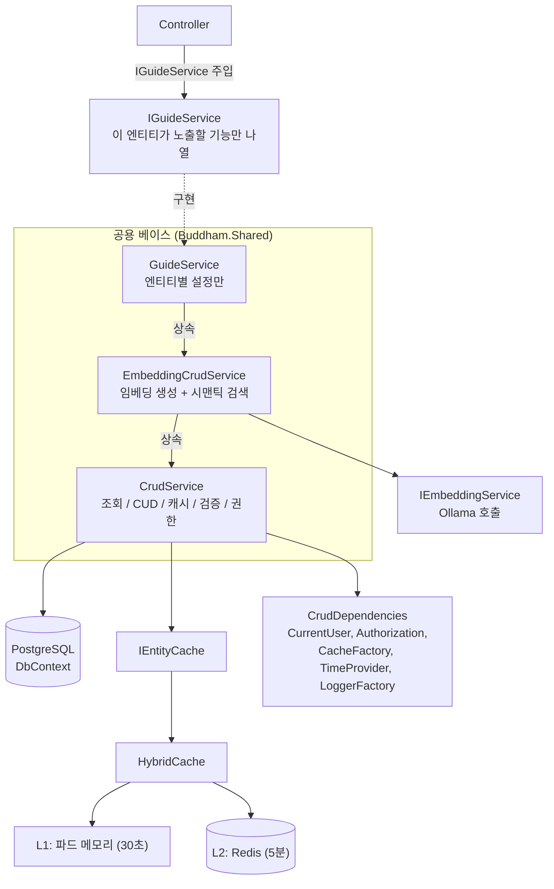
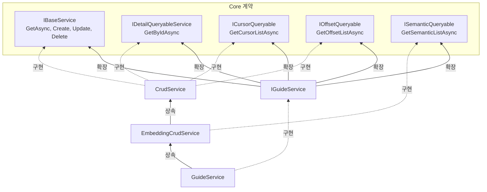
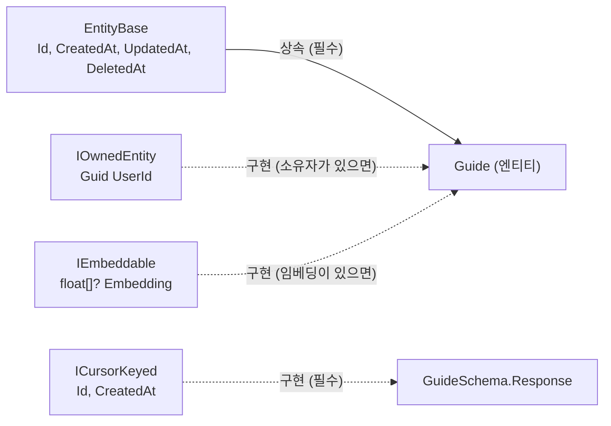
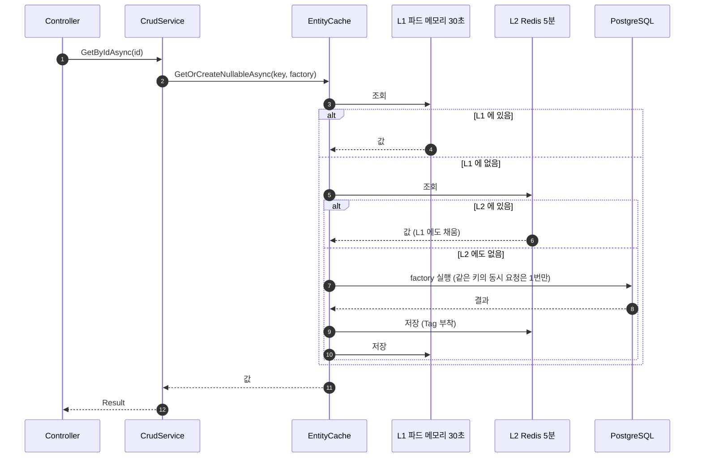
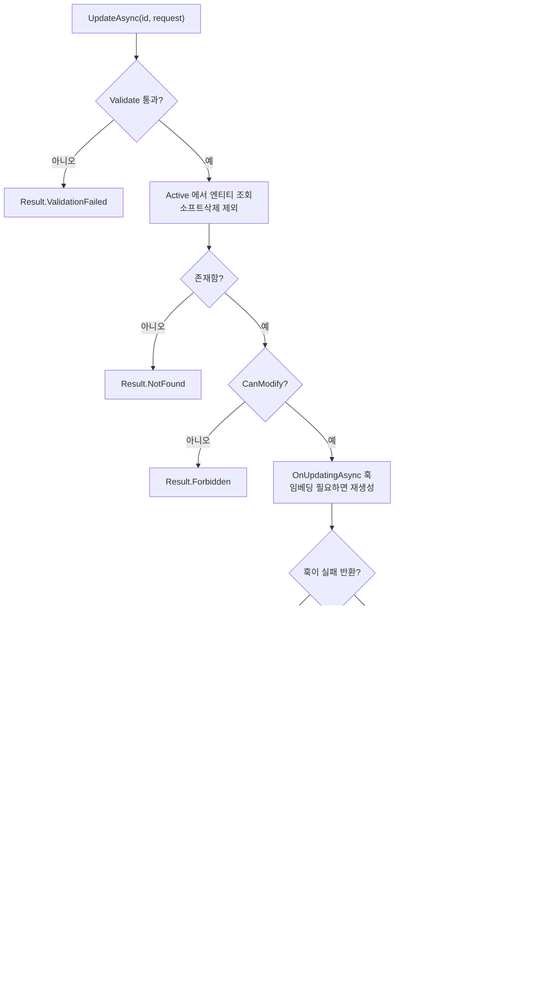
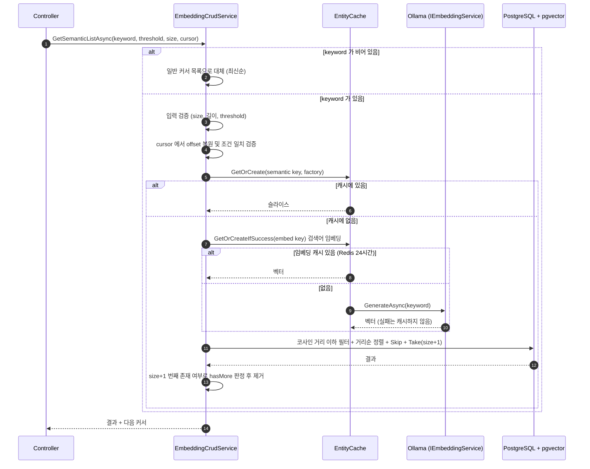
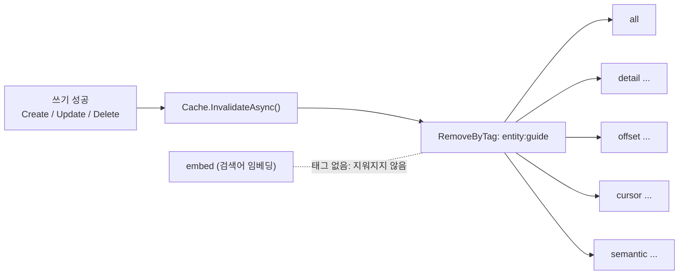
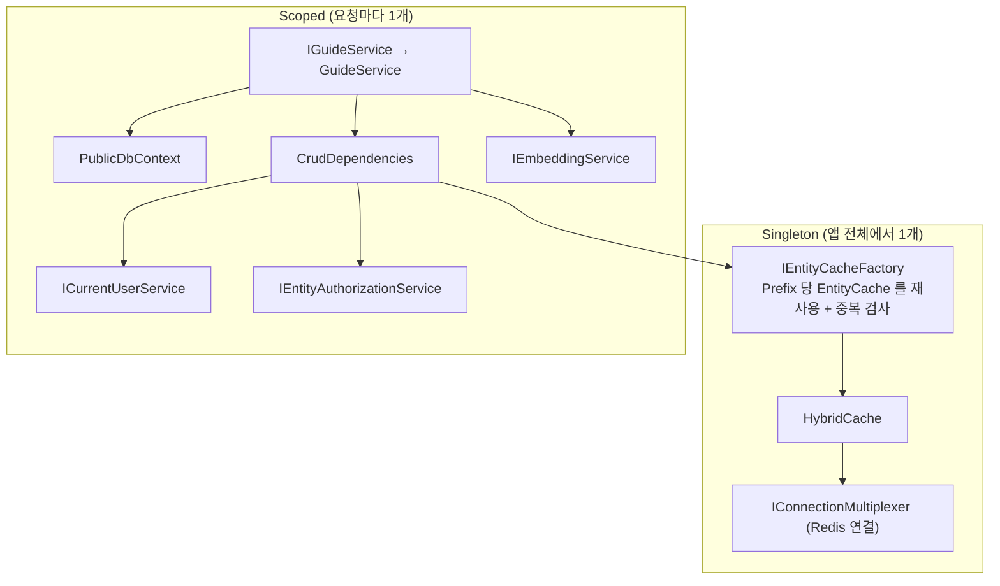

# CRUD 표준 서비스 구조 가이드

> 대상: Buddham 백엔드 유지보수 담당자
> 기준 구현: `GuideService` (표준 모델)
> 다이어그램은 Mermaid 입니다. GitHub 은 그대로 보이고, VS Code 는 확장 **"Markdown Preview Mermaid Support"** 를 설치한 뒤 미리보기(⇧⌘V)로 보세요.

---

## 0. 한 문단 요약

엔티티마다 반복되던 **조회 / 캐시 / 검증 / 권한 / 임베딩 / 시맨틱 검색 / 생성·수정·삭제** 로직을 공용 베이스 클래스로 옮겼다.
엔티티별 서비스(`GuideService` 등)는 **"우리 엔티티는 이렇게 생겼다"** 만 선언한다(약 55줄).
그래서 서비스가 50개로 늘어도 버그 수정과 정책 변경은 **베이스 한 곳**에서 끝난다.

```text
 ┌──────────────────────────────────────────────────────────────┐
 │  GuideService  (엔티티마다 다른 것: 매핑 · 검색필드 · 정렬 · 검증)   │  ← 서비스당 ~55줄
 ├──────────────────────────────────────────────────────────────┤
 │  EmbeddingCrudService  (임베딩 생성 · 시맨틱 검색)  ← 선택         │
 ├──────────────────────────────────────────────────────────────┤
 │  CrudService  (조회 · CUD · 캐시 · 검증 · 권한 · 소프트삭제)        │  ← 공용
 ├──────────────────────────────────────────────────────────────┤
 │  IEntityCache  →  HybridCache  →  L1 메모리 / L2 Redis         │  ← 공용
 └──────────────────────────────────────────────────────────────┘
```

---

## 1. 파일 지도

> 실제 폴더는 프로젝트 구성에 맞게 확인하세요. 아래는 역할 기준입니다.

```text
Buddham.Core  (계약 · 모델: 구현 없음)
├─ Common/Primitives/EntityBase.cs            Id, CreatedAt, UpdatedAt, DeletedAt
├─ Common/Options/EntityCacheOptions.cs       캐시 정책(Prefix, Tag, TTL)
├─ Interfaces/IBaseService.cs                 IBaseService, IDetailQueryableService,
│                                             ICursorQueryable, IOffsetQueryable, ISemanticQueryable
├─ Interfaces/Common/                         ICursorKeyed, IEmbeddable, IOwnedEntity,
│                                             IEmbeddingService, IEntityAuthorizationService, ICurrentUserService
└─ Interfaces/Cache/                          IEntityCache, IEntityCacheFactory,
                                              IRedisCacheService (레거시, 다른 서비스가 아직 사용)

Buddham.Shared  (구현)
├─ Caching/                                   EntityCache, EntityCacheFactory, EntityCacheOptionsFactory,
│                                             CacheBox, CacheProfiles
├─ Services/Crud/                             CrudService, EmbeddingCrudService, CrudDependencies,
│                                             QueryKit(Paging, LikeSearch, SortMap, Validator, OffsetSlice)
├─ Services/Public/GuideService.cs            ★ 표준 모델 (새 서비스는 이걸 복사해서 시작)
├─ Services/Common/                           EmbeddingService, EntityAuthorizationService, CurrentUserService
└─ Extensions/ServiceCollectionExtensions.cs  DI 등록 (AddRedisCaching, AddBusinessService)
```

**읽는 순서 추천:** `GuideService` → `CrudService` → `EntityCache` → `EmbeddingCrudService`

---

## 2. 전체 구조 (누가 누구를 부르나)



**핵심 포인트**
- 컨트롤러는 `IGuideService` 만 안다. 베이스 클래스의 존재를 모른다.
- 어떤 기능을 열지는 `IGuideService` 가 정한다. 임베딩이 없는 엔티티는 `ISemanticQueryable` 을 빼면 된다.
- 베이스는 DB, 캐시, 사용자 정보를 직접 만들지 않고 `CrudDependencies` 한 묶음으로 받는다.

---

## 3. 계약(인터페이스)과 상속 관계



### 엔티티와 응답에 붙여야 하는 인터페이스



| 붙이는 곳 | 인터페이스 | 필수 여부 | 안 붙이면 |
|---|---|---|---|
| 엔티티 | `EntityBase` 상속 | 필수 | 컴파일 오류 CS0311 |
| 엔티티 | `IOwnedEntity` | 소유자가 있을 때 | 수정/삭제가 **관리자 전용**이 됨 |
| 엔티티 | `IEmbeddable` | 임베딩이 있을 때 | `EmbeddingCrudService` 사용 불가 |
| 응답 | `ICursorKeyed` | 필수 | 컴파일 오류 CS0311 |

---

## 4. 읽기 흐름 (캐시)

모든 조회는 캐시를 거친다. 캐시에 없을 때만 DB 로 간다.



### 조회 메서드별 정리

| 메서드 | 용도 | 캐시 키 종류(kind) | 비고 |
|---|---|---|---|
| `GetAsync` | 전체 목록 | `all` | `MaxPageSize` 로 상한 |
| `GetByIdAsync` | 단건 | `detail` | **없는 Id 도 캐시**(생성 시 태그 무효화로 정리) |
| `GetOffsetListAsync` | 페이지 번호형 | `offset` | 관리자 화면용. 총 개수 포함 |
| `GetCursorListAsync` | 무한 스크롤형 | `cursor` | `CreatedAt + Id` 커서 |
| `GetSemanticListAsync` | 의미 검색 | `semantic`, `embed` | 임베딩 엔티티만 |

### 커서 vs 오프셋, 언제 쓰나

| | 커서 | 오프셋 |
|---|---|---|
| 적합한 화면 | 피드, 무한 스크롤 | 관리자 목록(1, 2, 3… 페이지) |
| 장점 | 깊은 페이지도 빠름, 중간 삽입에 안정적 | 특정 페이지로 점프 가능 |
| 단점 | 페이지 점프 불가 | 깊은 페이지에서 느려짐 |

---

## 5. 쓰기 흐름 (생성 / 수정 / 삭제)

### 수정(`UpdateAsync`) 상세 흐름



### 세 가지 쓰기 비교

| | `CreateAsync` | `UpdateAsync` | `DeleteAsync` |
|---|---|---|---|
| 로그인 확인 | ✅ (`UserId` 없으면 Unauthorized) | – | – |
| 요청 검증 | ✅ | ✅ | – |
| 대상 조회 | – | ✅ (`Active`) | ✅ (`Active`) |
| 권한 확인 | – | ✅ `CanModify` | ✅ `CanModify` |
| 훅 | `OnCreatingAsync` (저장 전) | `OnUpdatingAsync` (**ApplyUpdate 전**) | 없음 |
| 저장 | `Add` + Save | 변경 추적 + Save | `DeletedAt`, `UpdatedAt` 설정 후 Save (**소프트 삭제**) |
| 성공 후 | 캐시 무효화 → `Created` | 캐시 무효화 → `Updated` | 캐시 무효화 → `Success` |

> **규칙:** 캐시 무효화는 **DB 저장이 성공한 뒤에만** 한다.
> 저장 실패 시 캐시는 그대로 두므로 이전 데이터가 안전하게 유지된다.

### 왜 `OnUpdatingAsync` 가 `ApplyUpdate` **앞**인가

임베딩은 "제목/본문이 **바뀌었을 때만**" 다시 만든다(Ollama 호출 비용 절약).
바뀌었는지 비교하려면 **옛 값이 아직 엔티티에 남아 있어야** 하므로, 훅이 먼저 실행된다.
그래서 `ApplyUpdate` 는 `Embedding` 을 **절대 건드리면 안 된다**(베이스가 이미 세팅했다).

---

## 6. 시맨틱(의미) 검색 흐름



**알아둘 점**
- 의미 검색은 DB 커서가 아니라 **offset 을 커서 토큰에 담아** 흉내 낸다. 그래서 `MaxSemanticOffset` 상한이 있다.
- 커서에 `keyword`, `threshold` 가 들어 있어서, **검색 조건이 바뀌면 이전 커서는 거부**된다.
- 첫 페이지(`offset == 0`)에서만 총 개수를 센다.
- 검색어 임베딩은 **데이터와 무관**하므로 태그 없이 Redis 에만 24시간 저장한다(엔티티가 바뀌어도 지우지 않는다).
- 임베딩 실패는 **캐시하지 않는다.**

---

## 7. 캐시 구조

### 7-1. 키는 이렇게 생겼다

```text
 guide:v2 : offset : 3F9A1C…(SHA256 64자)
 └──┬───┘   └──┬──┘   └──────────┬──────────┘
  Prefix     kind        파라미터 해시
  엔티티+버전  조회 종류    keyword, sortBy, page 등을 해시
```

- 파라미터를 **해시**하므로 키 길이와 특수문자 문제가 없다.
- 같은 요청이면 **파드가 달라도 같은 키**가 나온다(결정적).

### 7-2. 태그로 한 번에 지운다



### 7-3. 수명과 지연

| 구분 | TTL | 의미 |
|---|---|---|
| L1 (파드 메모리) | **30초** | 다른 파드에서 옛 데이터가 보일 수 있는 **최대 지연** |
| L2 (Redis) | **5분** | 무효화가 실패해도 이 시간 뒤에는 자연 소멸(최후의 안전망) |
| 검색어 임베딩 | 24시간, Redis 전용 | 같은 검색어의 Ollama 재호출 방지 |

- 무효화 중 캐시 장애가 나도 **쓰기 결과는 성공**으로 둔다(경고 로그만 남김).
- 요청이 취소돼도 무효화는 끝까지 수행한다(DB 는 이미 커밋됐으므로).

### 7-4. 응답 모양을 바꿨다면? → 버전을 올린다

```csharp
EntityCacheOptionsFactory.For<Guide>("법문 가이드", version: 2);   // 2 → 3
```

배포 직후 이전 버전으로 직렬화된 캐시를 읽다가 깨지는 일을 막는다. 이전 키는 TTL 이 지나면 사라진다.

---

## 8. 의존성 주입(DI) 수명



| 등록 위치 | 내용 |
|---|---|
| `AddRedisCaching` | Redis, HybridCache, `IEntityCacheFactory`(Singleton) |
| `AddBusinessService` | `CrudDependencies`(Scoped), `IGuideService` 등 서비스(Scoped) |

> `CrudDependencies` 가 Scoped 인 이유: 안에 요청마다 달라지는 `ICurrentUserService` 가 있다.
> `IEntityCacheFactory` 가 Singleton 인 이유: 상태가 없고 앱 전체가 공유해도 안전하다.

---

## 9. 훅(오버라이드 지점) 지도

엔티티 서비스가 채우는 부분입니다.

### 필수 (abstract)

| 멤버 | 하는 일 | `GuideService` 예 |
|---|---|---|
| `Project(query)` | 엔티티 → 응답 투영 | `query.AsSummary()` |
| `ToEntity(request, userId, now)` | 요청 → 새 엔티티 | `request.ToEntity(userId, now)` |
| `ApplyUpdate(entity, request, now)` | 수정 필드 반영 (**Embedding 건드리지 말 것**) | `entity.ApplyUpdate(request, now)` |
| `Validate(request)` | 요청 검증 (통과하면 `null`) | `new Validator().Text(...).ToResult()` |
| `EmbeddingText(request)` / `EmbeddingText(entity)` | 임베딩 입력 문자열 (`EmbeddingCrudService` 만) | `BuildEmbeddingText(title, content)` |

### 선택 (virtual)

| 멤버 | 기본 동작 | 언제 override |
|---|---|---|
| `SearchFields` | 비어 있음(키워드 무시) | 키워드 검색을 쓰는 엔티티 |
| `Sorts` | `id` 만 허용 | 제목 등 다른 정렬이 필요할 때 |
| `CanModify(entity)` | 소유자 본인 또는 관리자 / 소유자 없으면 관리자만 | 특수한 권한 규칙 |
| `OnCreatingAsync` | 아무것도 안 함 | 저장 전 추가 처리 |
| `OnUpdatingAsync` | 아무것도 안 함 | 수정 전 추가 처리 |
| 공개 메서드 전부 | 표준 동작 | 통째로 바꿔야 하는 예외 케이스 |

### "무엇을 바꾸려면 어디를 보나"

| 바꾸고 싶은 것 | 위치 |
|---|---|
| 검색 대상 컬럼 | `SearchFields` |
| 정렬 가능한 컬럼 | `Sorts` |
| 입력 검증 규칙 | `Validate` (`Validator` 체이닝) |
| 페이지 크기·검색어 길이 상한 | `AppInfrastructure` 상수, `Paging` |
| 캐시 TTL | `For<>(…) with { Expiration = …, LocalExpiration = … }` |
| 응답 모양 변경 후 배포 | `For<>` 의 `version` 올리기 |
| 권한 정책(관리자 / 본인) | `EntityAuthorizationService.CanModify` (전체 공통) |
| 임베딩 입력 텍스트 | `EmbeddingText` 두 개 |
| Redis/HybridCache 전역 설정 | `AddRedisCaching` |

---

## 10. 새 서비스 만들기 (복사해서 시작)

### 체크리스트

1. **엔티티:** `EntityBase` 상속. 소유자가 있으면 `IOwnedEntity`, 임베딩이 있으면 `IEmbeddable` 추가
2. **응답:** `ICursorKeyed` 구현. **사용자별 필드는 넣지 않는다**(캐시는 모두가 공유)
3. **`IXxxService`:** 필요한 기능 인터페이스만 나열
4. **서비스 클래스:** `CrudService`(임베딩이 있으면 `EmbeddingCrudService`) 상속 후 훅 채우기
5. **DI:** `AddBusinessService` 에 `services.AddScoped<IXxxService, XxxService>();`
6. **첫 실행:** 캐시 Prefix/Tag 중복 예외가 없는지 확인

### 템플릿 (임베딩 없는 엔티티)

```csharp
public sealed class NoticeService(PublicDbContext context, CrudDependencies deps)
    : CrudService<Notice, NoticeSchema.Request, NoticeSchema.Response>(context, deps, NoticeCacheOptions),
      INoticeService
{
    // Prefix/Tag 는 타입 이름에서 자동 생성 → 복붙 실수 방지
    private static readonly EntityCacheOptions NoticeCacheOptions =
        EntityCacheOptionsFactory.For<Notice>("공지", version: 1);

    // static readonly: 요청마다 새로 만들지 않는다
    private static readonly SortMap<Notice> NoticeSorts =
        new SortMap<Notice>().Add("id", x => x.Id).Add("title", x => x.Title);

    private static readonly Expression<Func<Notice, string?>>[] NoticeSearchFields =
        [x => x.Title];

    protected override SortMap<Notice> Sorts => NoticeSorts;
    protected override IReadOnlyList<Expression<Func<Notice, string?>>> SearchFields => NoticeSearchFields;

    protected override IQueryable<NoticeSchema.Response> Project(IQueryable<Notice> query)
        => query.AsSummary();

    protected override Notice ToEntity(NoticeSchema.Request request, Guid userId, DateTime now)
        => request.ToEntity(userId, now);

    protected override void ApplyUpdate(Notice entity, NoticeSchema.Request request, DateTime now)
        => entity.ApplyUpdate(request, now);

    protected override Result? Validate(NoticeSchema.Request request)
        => new Validator()
            .Text("title", request.Title, "제목", AppInfrastructure.MaxTitleLength)
            .ToResult();
}
```

임베딩이 있는 엔티티는 `GuideService` 를 복사하세요. 위 항목에 `IEmbeddingService` 주입과 `EmbeddingText` 두 개가 더 들어갑니다.

---

## 11. 반드시 지킬 규칙

| # | 규칙 | 어기면 |
|---|---|---|
| 1 | **캐시 Prefix/Tag 는 엔티티마다 고유** (`For<TEntity>` 사용) | 다른 엔티티의 캐시를 읽음. 중복 시 시작 후 첫 호출에서 예외 |
| 2 | **응답에 사용자별 데이터 금지** (예: "내가 좋아요 눌렀는가") | 다른 사용자에게 값이 새어 나감. 해당 엔티티는 조회 메서드를 `override` 해서 캐시를 우회 |
| 3 | 응답 모양을 바꾸면 **`version` 올리기** | 배포 직후 옛 캐시 역직렬화 오류 |
| 4 | 조회/수정은 **반드시 `Active`** 를 통해서 | 소프트 삭제된 데이터가 노출됨 |
| 5 | `ApplyUpdate` 에서 **`Embedding` 을 건드리지 않기** | 임베딩이 옛 값/빈 값으로 덮임 |
| 6 | 캐시 무효화는 **저장 성공 후에만** | 저장 실패인데 캐시만 사라짐 |
| 7 | 검증은 **캐시 키를 만들기 전에** | 잘못된 요청이 캐시 키를 차지 |
| 8 | 정렬 컬럼은 `SortMap` **화이트리스트**로만 | 임의 컬럼 정렬 시도, 캐시 키 폭증 |

---

## 12. 문제 해결 표

| 증상 | 가능한 원인 | 확인/해결 |
|---|---|---|
| 시작 후 **"캐시 Prefix … 중복"** 예외 | 서비스 복붙 후 Prefix/Tag 미변경 | `For<TEntity>` 사용, 두 서비스의 옵션 확인 |
| 수정했는데 **목록이 안 바뀜** | ① L1 지연(최대 30초) ② 무효화 실패(경고 로그 `cache invalidation failed`) ③ 다른 서비스가 같은 Tag 사용 | 로그에서 경고 검색 → Redis 상태 확인. 최악에도 5분 뒤 자동 복구 |
| 컴파일 오류 **CS0311** | 엔티티/응답에 인터페이스 미적용 | §3 표 확인 |
| 컴파일 오류 **CS0452** | 응답 타입 제약에 `class` 누락 | `where TResponse : class, ICursorKeyed` |
| 수정/삭제가 **항상 403** | 엔티티에 `IOwnedEntity` 없음(→ 관리자 전용) 또는 소유자 불일치 | 엔티티에 `IOwnedEntity` 추가. 의도한 관리자 전용이면 정상 |
| 시맨틱 검색 결과가 **비어 있음** | ① `threshold` 가 너무 높음 ② 기존 데이터에 임베딩이 없음 ③ 임베딩 서비스 장애 | 기존 데이터 임베딩 backfill 확인, `threshold` 낮춰서 테스트 |
| 시맨틱 검색 **"일시적으로 사용할 수 없음"** | 검색어 임베딩 생성 실패(Ollama) | Ollama 상태/타임아웃 확인(`EmbeddingService` 로그) |
| 커서가 **"유효하지 않거나 조건이 변경됨"** | 검색어/threshold 를 바꾸고 이전 커서를 재사용 | 정상 동작. 새 검색은 커서 없이 시작 |
| 키워드 검색이 **느림** | `ILIKE '%kw%'` 는 일반 인덱스를 못 탐 | `pg_trgm` GIN 인덱스(`gin_trgm_ops`) 검토 |
| 깊은 페이지 요청이 **느림/거부됨** | 오프셋 깊이 한도 | 검색 조건을 좁히거나 커서 방식 사용 |

---

## 13. 알려진 한계와 향후 과제

| 항목 | 내용 | 대응 |
|---|---|---|
| 읽기-쓰기 경합 | 읽는 도중 쓰기가 끼면 오래된 값이 **최대 5분** 캐시에 남을 수 있음 | TTL 이 안전망. 수용 |
| 동시 수정 | 낙관적 동시성 토큰이 없어 **마지막 쓰기가 이김** | 필요한 엔티티에만 Postgres `xmin` 도입 |
| 시맨틱 검색 비용 | 검색어마다 임베딩 호출 + Redis 저장 | 시맨틱 엔드포인트에 **레이트리밋 정책** 적용 |
| 다중 파드 무효화 | 태그 무효화의 L1 반영 방식은 `HybridCache` 버전에 따라 다를 수 있음 | Redis + 2 인스턴스로 "수정 후 다른 인스턴스 조회" 1회 검증 |
| HNSW 후보 수 | 인덱스는 기본 `hnsw.ef_search`(40) 개 후보만 반환 | 데이터 증가 시 상향 또는 pgvector iterative scan 검토 |
| 컨트롤러 | 엔드포인트 보일러플레이트는 아직 개별 | `IBaseService<,,>` 기반 제네릭 컨트롤러로 통합 가능 |
| 레거시 캐시 | 일부 서비스는 `IRedisCacheService` 사용 중 | 순차적으로 `IEntityCache` 로 이전 |

---

## 14. 용어 사전

| 용어 | 뜻 |
|---|---|
| **HybridCache** | .NET 의 2단 캐시. L1(메모리) + L2(Redis)를 하나처럼 쓴다 |
| **L1 / L2** | L1 = 파드(프로세스) 안의 빠른 메모리 / L2 = 모든 파드가 공유하는 Redis |
| **스탬피드 방지** | 같은 키가 동시에 만료돼도 DB 조회는 **한 번만** 하게 막는 것 |
| **Tag(태그)** | 캐시 항목에 붙이는 꼬리표. 태그 하나로 관련 항목을 한꺼번에 삭제 |
| **Prefix** | 캐시 키의 앞부분(엔티티 + 버전). 엔티티끼리 키가 섞이지 않게 한다 |
| **소프트 삭제** | 행을 지우지 않고 `DeletedAt` 만 채워서 숨기는 방식 |
| **`Active`** | 소프트 삭제되지 않은 데이터만 모은 쿼리. 모든 조회/수정의 출발점 |
| **커서 페이징** | "마지막으로 본 항목 다음부터"로 이어 읽는 방식(`CreatedAt + Id`) |
| **오프셋 페이징** | "N 번째 페이지"로 읽는 방식(페이지 번호 + 크기) |
| **임베딩(Embedding)** | 텍스트를 의미를 담은 숫자 벡터(1024개)로 바꾼 것 |
| **코사인 거리** | 두 벡터가 얼마나 다른 방향인지(작을수록 의미가 비슷). 유사도 = 1 − 거리 |
| **Threshold** | 이 유사도 이상인 것만 결과에 포함하는 기준(0 ~ 1) |
| **HNSW** | 벡터 근사 검색용 인덱스. 빠른 대신 후보 수 제한이 있다 |
| **훅(Hook)** | 베이스가 정해진 시점에 호출해 주는 `virtual` 메서드 |

---

## 15. 표준안 반영 확인 체크리스트

이 문서는 **목표 상태**를 설명합니다. 코드에 아래가 반영됐는지 확인하세요.

- [ ] `ICrudService`, `ISemanticSearchService` 삭제 → `CrudService` 가 `IBaseService`, `IDetailQueryableService`, `ICursorQueryable`, `IOffsetQueryable` 을, `EmbeddingCrudService` 가 `ISemanticQueryable` 을 직접 구현
- [ ] 서비스의 캐시 옵션이 `EntityCacheOptionsFactory.For<TEntity>` 사용
- [ ] `EntityCacheFactory` 가 Prefix 재사용 + 중복 검사 버전
- [ ] `SortMap.Resolve` 로 정렬값 정규화 (캐시 키 폭증 방지)
- [ ] `Sorts` / `SearchFields` 를 `static readonly` 로 보관
- [ ] `CanModify` 기본값이 `Deps.Authorization.CanModify((entity as IOwnedEntity)?.UserId)`
- [ ] 오프셋 깊이 상한(`Paging.EnsureOffsetPage`) 추가 (선택)
- [ ] 시맨틱 엔드포인트 레이트리밋 정책 (선택, 권장)
- [ ] `IOwnerEntity.cs` 파일명 → `IOwnedEntity.cs`, `IsAuthenticatied` 오타 수정 (선택)
