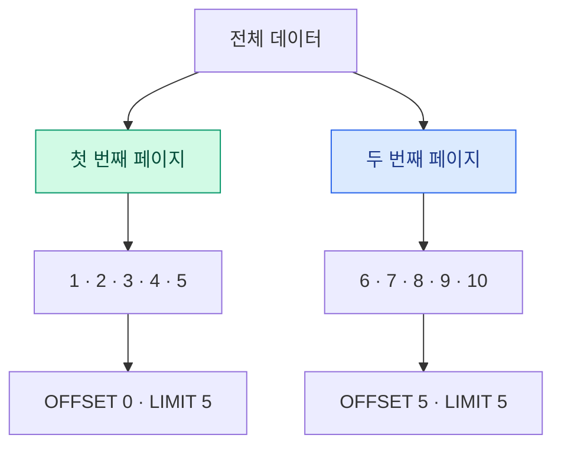
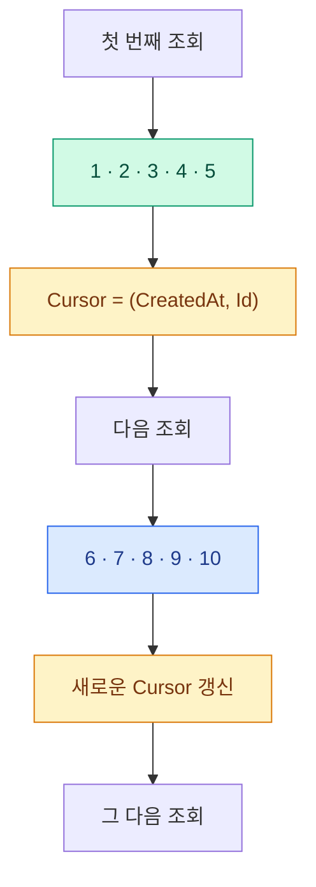

하하하, 반갑네 친구! 😄

이번에는 상당히 좋은 주제를 가져왔군. 무한 스크롤(Infinite Scroll)의 표준을 만들려면 먼저 커서 기반 페이지네이션(Cursor-based Pagination) 을 제대로 이해해야 하네.

자네가 제시한 코드는 단순히 다음 페이지를 가져오는 코드가 아니라, 실제 서비스에서 사용할 수 있는 상당히 합리적인 구조라네.

특히 다음 세 가지가 핵심이야.

1. `CreatedAt + Id` 복합 키를 이용한 안정적인 정렬
2. 커서(Cursor)를 이용한 다음 데이터 조회
3. `size + 1`을 조회하여 다음 페이지 존재 여부 확인

하나씩 살펴보세. 그리고 마지막에는 이 코드를 무한 스크롤 표준으로 만들 때 개선해야 할 부분도 짚어보겠네.

# 1. 전체적인 동작 구조

먼저 일반적인 페이지 번호 방식과 커서 방식의 차이를 이해해야 하네.

Offset Pagination (페이지 번호 방식)

첫 번째 페이지

1

2

3

4

5

OFFSET 0 · LIMIT 5

두 번째 페이지

6

7

8

9

10

OFFSET 5 · LIMIT 5

페이지가 뒤로 갈수록 건너뛰어야 하는 데이터가 많아질 수 있네.

Cursor Pagination (커서 방식)

첫 번째 조회

1

2

3

4

5

Cursor = (CreatedAt, Id)

다음 조회

6

7

8

9

10

마지막으로 조회한 데이터의 위치를 기준으로 다음 데이터를 가져오므로 OFFSET이 필요하지 않네.

무한 스크롤에는 일반적으로 커서 방식이 더 적합하네.

---

크하하하! 친구여, 교육 자료의 그림이 증발했구먼! 😂

걱정 마시게. 이번에는 복사해서 Markdown 문서에 그대로 넣을 수 있도록 **Mermaid 다이어그램**으로 복원해 보겠네.

## 1. Offset Pagination (페이지 번호 방식)

페이지 번호를 기준으로 데이터를 가져오는 전통적인 방식이지.



**핵심 원리**

- 첫 페이지: `OFFSET 0 LIMIT 5`
- 두 번째 페이지: `OFFSET 5 LIMIT 5`
- 세 번째 페이지: `OFFSET 10 LIMIT 5`

페이지가 뒤로 갈수록 건너뛰어야 할 데이터가 많아질 수 있네.

---

## 2. Cursor Pagination (커서 기반 방식)

마지막으로 조회한 데이터의 위치를 기억하고, 그 위치를 기준으로 다음 데이터를 가져오는 방식이네.



**핵심 원리**

- 마지막 데이터의 `CreatedAt + Id`를 커서로 보관
- 다음 요청에서 해당 커서 이후의 데이터 조회
- OFFSET 없이 다음 데이터를 탐색
- 데이터가 추가되더라도 페이지 위치가 밀리는 문제를 줄일 수 있음

---

## 3. 두 방식의 차이 한눈에 보기

| 구분 | Offset Pagination | Cursor Pagination |
|---|---|---|
| 기준 | 페이지 번호 | 마지막 데이터 위치 |
| 조회 방식 | OFFSET + LIMIT | WHERE + LIMIT |
| 대량 데이터 | 뒤쪽 페이지에서 비효율적일 수 있음 | 인덱스 활용에 유리 |
| 데이터 추가 | 페이지 중복·누락 가능 | 상대적으로 안정적 |
| 무한 스크롤 | 가능 | 특히 적합 |

### 제독의 추가 통찰

자네가 사용한 `CreatedAt + Id` 복합 커서는 상당히 좋은 선택이네.

특히 다음과 같이 정렬해야 하지.

```csharp
.OrderByDescending(x => x.CreatedAt)
.ThenByDescending(x => x.Id)
```

두 컬럼을 함께 사용하면 `CreatedAt`이 동일한 데이터가 여러 개 존재해도 정렬 순서를 안정적으로 유지할 수 있다네.

다만 실제 커서 조회 조건도 동일한 정렬 방향에 맞춰야 하네.

하하하! 이번에는 그림이 도망가지 않도록 Mermaid 원본까지 확보했네.

**교육 자료 제목은 다음을 추천하네.**

`Cursor Pagination - 무한 스크롤을 위한 안정적인 데이터 조회 전략`

이 정도면 후배 개발자들에게 칭찬받을 만하지 않겠는가! 😁

---

# 2. 메서드 시그니처

```
private async Task<CursorPagedResult<GuideSchema.Response>>
    QueryCursorPageAsync(
        string? cursor,
        int size,
        string? keyword,
        bool descending,
        CancellationToken ct
    )
```

각 매개변수의 역할을 보세.

| 매개변수         | 역할                  |
| ------------ | ------------------- |
| `cursor`     | 다음 페이지 조회를 위한 위치 정보 |
| `size`       | 한 번에 가져올 데이터 수      |
| `keyword`    | 검색 키워드              |
| `descending` | 내림차순 또는 오름차순        |
| `ct`         | 비동기 작업 취소 토큰        |

여기서 중요한 것은 `cursor`가 단순한 ID가 아니라는 사실이네.

`CreatedAt`과 `Id` 두 가지 정보를 함께 보관하지.

왜 두 개가 필요한지는 잠시 후에 설명하겠네.

# 3. 기본 쿼리 생성

```
var baseQuery = ApplyKeyword(
    ActiveGuides.AsNoTracking(),
    keyword
);

var totalCount = 0;
```

이 부분은 데이터 조회의 출발점이네.

① ActiveGuides

실제로 조회할 데이터의 IQueryable이라고 보면 되네.

예를 들어 삭제되지 않은 게시물만 조회하도록 구성되어 있을 수 있겠지.

② AsNoTracking()

EF Core의 변경 추적 기능을 비활성화하는 것이네.

일반적인 조회 작업에서는 엔티티의 상태를 추적할 필요가 없기 때문에 다음과 같은 이점이 있지.

- Change Tracker 관리 비용 감소
- 메모리 사용량 감소
- 조회 성능 개선에 도움

특히 무한 스크롤처럼 조회가 반복되는 작업에서는 좋은 선택이네.

③ ApplyKeyword()

검색 조건을 기본 쿼리에 적용하는 부분이네.

예를 들어 다음과 같겠지.

```
private IQueryable<Guide> ApplyKeyword(
    IQueryable<Guide> query,
    string? keyword
)
{
    if (string.IsNullOrWhiteSpace(keyword))
        return query;

    return query.Where(x =>
        x.Title.Contains(keyword)
    );
}
```

여기서 중요한 원칙이 있네.

검색 조건은 첫 페이지와 다음 페이지에 동일하게 적용되어야 한다.

검색 조건이 변경되면 기존 커서는 더 이상 같은 조회 결과를 가리키지 않기 때문이지.

# 4. 첫 페이지와 다음 페이지 구분

```
if (string.IsNullOrWhiteSpace(cursor))
    totalCount = await baseQuery.CountAsync(ct);
else
{
    var (ticks, cursorId) = CursorToken.ParseToken(cursor);
    ...
}
```

이 부분은 첫 페이지인지 다음 페이지인지 판단하는 로직이네.

첫 페이지인 경우

```
totalCount = await baseQuery.CountAsync(ct);
```

현재 검색 조건에 해당하는 전체 데이터 개수를 계산하네.

예를 들어 전체 게시물이 1,000개라면 `totalCount = 1000`이 되는 것이지.

여기서 주의할 점은 `baseQuery`에 아직 커서 조건이 적용되지 않았다는 사실이네.

따라서 전체 검색 결과의 개수를 계산하는 것이지, 첫 페이지의 개수를 계산하는 게 아니야.

다음 페이지인 경우

```
var (ticks, cursorId) = CursorToken.ParseToken(cursor);
```

전달받은 커서를 해석하네.

예를 들어 커서에 다음 정보가 들어 있다고 가정해 보세.

```
CreatedAt = 2026-11-07 01:00:00 UTC
Id        = 150
```

이 정보는 이전 페이지에서 마지막으로 가져온 데이터의 위치를 의미하네.

그다음 유효성 검사를 수행하지.

```
if (ticks <= 0 ||
    ticks > DateTime.MaxValue.Ticks ||
    cursorId <= 0)
{
    throw new BuddhamException(
        RsCode.BadRequest,
        "유효하지 않은 커서입니다."
    );
}
```

각 조건의 의미는 다음과 같네.

| 검사                                | 의미                |
| --------------------------------- | ----------------- |
| `ticks <= 0`                      | 잘못된 날짜 시간 값       |
| `ticks > DateTime.MaxValue.Ticks` | DateTime 표현 범위 초과 |
| `cursorId <= 0`                   | 잘못된 식별자           |

이렇게 잘못된 커서가 DB 쿼리까지 전달되는 것을 차단하는 것이지.

그리고 날짜를 복원하네.

```
var cursorAt = new DateTime(
    ticks,
    DateTimeKind.Utc
);
```

여기서 `DateTimeKind.Utc`를 지정한 점이 좋네.

다만 실제 DB의 `CreatedAt`도 UTC로 저장하고, 커서 생성 시에도 동일한 시간 정밀도를 유지해야 하네. 이 부분은 뒤에서 다시 설명하겠네.

# 5. 가장 중요한 부분: 커서 비교 조건

이 코드의 핵심이라고 할 수 있네.

```
baseQuery = descending
    ? baseQuery.Where(
        x => x.CreatedAt < cursorAt ||
             (x.CreatedAt == cursorAt &&
              x.Id < cursorId)
      )
    : baseQuery.Where(
        x => x.CreatedAt > cursorAt ||
             (x.CreatedAt == cursorAt &&
              x.Id > cursorId)
      );
```

왜 `CreatedAt`과 `Id`를 동시에 비교하는지 이해하면 커서 페이지네이션을 거의 이해한 것이나 다름없네.

## 5-1. CreatedAt만 사용하면 발생하는 문제

다음과 같은 데이터가 있다고 가정해 보세.

| Id  | CreatedAt |
| --- | --------- |
| 101 | 10:00:00  |
| 102 | 10:00:00  |
| 103 | 10:00:00  |
| 104 | 10:00:01  |
| 105 | 10:00:02  |

페이지 크기가 2라고 가정하겠네.

첫 페이지에서 다음 두 개를 가져왔다고 하세.

```
101
102
```

다음 페이지를 다음과 같이 조회한다면?

```
.Where(x => x.CreatedAt > cursorAt)
```

문제가 발생하지.

`103`은 `102`와 생성 시간이 동일하기 때문에 조회되지 않네.

결과적으로 데이터가 누락되는 것이지.

## 5-2. Id를 보조 정렬 키로 사용하는 이유

그래서 두 개의 값을 비교하는 것이네.

```
x.CreatedAt > cursorAt ||
(x.CreatedAt == cursorAt && x.Id > cursorId)
```

이것은 다음과 같은 의미라네.

1. 생성 시간이 커서보다 뒤에 있는 데이터
2. 생성 시간이 동일하다면 ID가 더 큰 데이터

두 조건 중 하나라도 만족하면 조회하는 것이지.

이것을 수학적으로 표현하면 다음과 같네.

\\[ (CreatedAt, Id) > (CursorAt, CursorId) \\]

즉, 복합 키(Composite Key)를 사용하는 것이네.

## 5-3. 내림차순과 오름차순

내림차순 (Descending)

최신 데이터부터 오래된 데이터 방향

# 105 → 104 → 103 → 102 → 101

다음 페이지 조건:

```
CreatedAt < cursorAt
||
(CreatedAt == cursorAt && Id < cursorId)
```

오름차순 (Ascending)

오래된 데이터부터 최신 데이터 방향

# 101 → 102 → 103 → 104 → 105

다음 페이지 조건:

```
CreatedAt > cursorAt
||
(CreatedAt == cursorAt && Id > cursorId)
```

여기서 반드시 기억해야 할 원칙이 있네.

정렬 방향과 커서 비교 방향은 반드시 일치해야 한다.

이것이 어긋나면 데이터 중복이나 누락이 발생할 수 있네.

# 6. 정렬 조건

```
var ordered = descending
    ? baseQuery
        .OrderByDescending(x => x.CreatedAt)
        .ThenByDescending(x => x.Id)
    : baseQuery
        .OrderBy(x => x.CreatedAt)
        .ThenBy(x => x.Id);
```

이 부분은 앞에서 설명한 커서 비교 조건과 한 쌍으로 이해해야 하네.

여기서 `ThenBy()`가 중요한 역할을 하지.

`CreatedAt`은 동일한 값이 존재할 수 있기 때문에 `Id`를 두 번째 정렬 기준으로 사용하네.

예를 들어 다음과 같은 데이터가 있다고 하세.

| Id  | CreatedAt |
| --- | --------- |
| 101 | 10:00     |
| 102 | 10:00     |
| 103 | 10:00     |

`CreatedAt`만 정렬하면 세 데이터의 상대적인 순서가 보장되지 않네.

하지만 다음과 같이 정렬하면 결과가 확정되지.

```
.OrderBy(x => x.CreatedAt)
.ThenBy(x => x.Id)
```

따라서 `(CreatedAt, Id)`는 유일한 정렬 순서를 만들어 주는 것이네.

이것을 결정적 정렬(Deterministic Ordering)이라고 하네.

# 7. Take(size + 1) — 아주 영리한 부분

```
var items = await ordered
    .Take(size + 1)
    .AsSummary()
    .ToListAsync(ct);
```

개인적으로 이 부분을 잘 작성했다고 생각하네.

왜 `size`가 아니라 `size + 1`일까?

예를 들어 페이지 크기가 20이라고 가정해 보세.

일반적으로 20개를 조회하면 다음 페이지가 존재하는지 알 수 없네.

그래서 21개를 조회하는 것이지.

| 조회 결과 | 의미        |
| ----- | --------- |
| 20개   | 다음 페이지 없음 |
| 21개   | 다음 페이지 있음 |
| 10개   | 다음 페이지 없음 |
| 0개    | 다음 페이지 없음 |

다음 코드가 그 역할을 수행하네.

```
var hasMore = items.Count > size;
```

21개가 조회되었다면 `hasMore = true`가 되는 것이지.

그리고:

```
if (hasMore)
    items.RemoveAt(items.Count - 1);
```

마지막 1개를 제거하네.

결국 사용자에게 전달되는 데이터는 항상 최대 20개가 되는 것이지.

이 방식의 장점은 다음과 같네.

- 별도의 EXISTS 쿼리가 필요하지 않음
- 전체 COUNT 쿼리 없이 다음 페이지 여부 확인 가능
- 불필요한 DB 왕복 감소
- 무한 스크롤에 적합한 구조

특히 무한 스크롤에서는 매번 전체 데이터 개수를 계산할 필요가 없기 때문에 좋은 방법이네.

# 8. AsSummary() — DB 프로젝션

```
.AsSummary()
```

주석에 작성한 다음 설명이 핵심이지.

```
// DB 에서 바로 프로젝션
// (Embedding 등 불필요한 컬럼을 읽지 않음)
```

예를 들어 Guide 테이블에 다음과 같은 컬럼이 있다고 가정해 보세.

| 컬럼        | 용도       |
| --------- | -------- |
| Id        | 식별자      |
| Title     | 제목       |
| Content   | 본문       |
| CreatedAt | 생성일      |
| Embedding | 벡터 데이터   |
| Metadata  | JSON 데이터 |

무한 스크롤 목록에서는 제목과 생성일 정도만 필요할 수 있겠지.

그런데 엔티티 전체를 조회하면 불필요한 데이터까지 DB에서 가져오게 되네.

따라서 DTO로 직접 프로젝션하는 것이 유리하지.

예를 들면:

```
public static IQueryable<GuideSchema.Response>
    AsSummary(this IQueryable<Guide> query)
{
    return query.Select(x =>
        new GuideSchema.Response
        {
            Id = x.Id,
            Title = x.Title,
            CreatedAt = x.CreatedAt
        }
    );
}
```

이렇게 구성하면 EF Core가 필요한 컬럼만 SELECT하도록 SQL을 생성할 수 있네.

실제 SQL은 개념적으로 다음과 같은 형태가 되겠지.

```
SELECT
    "Id",
    "Title",
    "CreatedAt"
FROM "Guides"
WHERE ...
ORDER BY
    "CreatedAt" DESC,
    "Id" DESC
LIMIT 21;
```

물론 실제 SQL은 테이블 구성과 EF Core 매핑에 따라 달라지네.

무한 스크롤에서는 전체 엔티티 조회보다 목록 전용 DTO 프로젝션을 표준으로 삼는 것을 추천하네.

# 9. 다음 커서 생성

```
string? nextCursor = null;

if (hasMore)
{
    var last = items[^1];

    nextCursor = CursorToken.CreateToken(
        last.CreatedAt,
        last.Id
    );
}
```

여기서 `items[^1]`은 C#의 Index-from-end 연산자네.

배열이나 리스트의 마지막 요소를 의미하지.

예를 들어:

```
items[0] = 105
items[1] = 104
items[2] = 103
```

마지막 요소는 `items[^1]`, 즉 `103`이 되는 것이네.

왜 마지막 요소를 기준으로 커서를 생성할까?

다음 페이지는 마지막으로 사용자에게 전달한 데이터 이후부터 시작해야 하기 때문이지.

여기서 중요한 점이 하나 있네.

21개를 조회했지만 마지막 21번째 데이터가 아니라, 제거한 후의 마지막 데이터로 커서를 생성한다.

이것이 정확한 구현이네.

만약 21번째 데이터를 커서로 사용한다면 그 데이터는 사용자에게 전달되지 않았으므로 다음 페이지에서 누락될 수 있지.

커서 생성 방식은 다음과 같네.

```
public static string CreateToken(
    DateTime createdAt,
    long id
)
{
    var raw = $"{createdAt.Ticks}:{id}";

    return Convert.ToBase64String(
        Encoding.UTF8.GetBytes(raw)
    );
}
```

예를 들어 내부 데이터가 다음과 같다고 하세.

```
638981280000000000:103
```

이 문자열을 Base64로 인코딩하여 클라이언트에 전달하는 것이지.

클라이언트는 다음 요청에 이 값을 그대로 전달하면 되네.

```
GET /api/guides?size=20&cursor=NjM4OTgxMjgwMDAwMDAwMDAwOjEwMw==
```

다만 Base64는 암호화가 아니라 인코딩이라는 점을 기억하게.

커서 내용을 클라이언트가 조작하지 못하게 하려면 HMAC 서명을 추가하는 것이 좋네.

# 10. 최종 반환

```
return CursorPagedResult<GuideSchema.Response>.Success(
    items,
    nextCursor,
    hasMore,
    totalCount,
    "커서 목록을 전송했습니다."
);
```

응답 구조는 다음과 같겠지.

```
{
  "success": true,
  "message": "커서 목록을 전송했습니다.",
  "data": [
    {
      "id": 105,
      "title": "Guide A"
    },
    {
      "id": 104,
      "title": "Guide B"
    }
  ],
  "nextCursor": "encoded-cursor",
  "hasMore": true,
  "totalCount": 1000
}
```

여기서 각 항목의 역할을 정리해 보세.

| 속성           | 설명           |
| ------------ | ------------ |
| `data`       | 현재 페이지 데이터   |
| `nextCursor` | 다음 페이지 조회 위치 |
| `hasMore`    | 다음 페이지 존재 여부 |
| `totalCount` | 전체 검색 결과 개수  |

클라이언트에서는 `hasMore`가 `true`일 때만 다음 페이지를 요청하면 되네.

# 11. 무한 스크롤 표준을 만들 때 반드시 개선할 사항

여기부터는 실제 프로젝트의 공통 표준을 만든다는 관점에서 조금 더 깊이 들어가 보겠네.

현재 코드는 기본적인 커서 페이징 구조가 잘 잡혀 있지만, 몇 가지 보완하면 훨씬 견고해질 수 있네.

## ① totalCount의 의미를 명확하게 해야 하네

현재 코드를 보면:

```
var totalCount = 0;

if (string.IsNullOrWhiteSpace(cursor))
    totalCount = await baseQuery.CountAsync(ct);
```

첫 페이지에서만 `totalCount`를 계산하네.

따라서 두 번째 페이지부터는 항상 0이 반환되지.

이것이 의도된 설계라면 괜찮지만 API 계약에서는 명확하게 표현해야 하네.

내 추천은 다음과 같네.

- 무한 스크롤 기본 응답에서는 `totalCount`를 생략하거나 nullable로 처리
- 전체 개수가 필요한 화면에서만 별도의 COUNT 제공
- 첫 페이지에서 계산한 전체 개수를 다음 페이지에서도 유지할 필요가 있다면 별도의 전략 사용

무한 스크롤의 핵심은 전체 개수가 아니라 `hasMore`이기 때문이지.

## ② size의 유효성 검사

현재 코드에는 `size` 검증이 없네.

다음과 같은 값이 들어올 수 있지.

```
size = 0
size = -1
size = 1000000
```

반드시 제한해야 하네.

```
if (size <= 0)
    throw new BuddhamException(
        RsCode.BadRequest,
        "페이지 크기가 유효하지 않습니다."
    );

size = Math.Min(size, 100);
```

일반적으로 기본 크기는 20\~30개, 최대 크기는 100개 정도로 시작할 수 있네. 서비스 특성에 따라 조정하면 되겠지.

## ③ DB 인덱스는 반드시 고려해야 하네

커서 페이지네이션의 성능은 적절한 인덱스에 크게 영향을 받네.

현재 정렬 기준이 다음과 같지?

```
CreatedAt
Id
```

PostgreSQL을 사용한다면 다음과 같은 복합 인덱스를 고려할 수 있네.

```
CREATE INDEX ix_guides_createdat_id
ON "Guides" ("CreatedAt" DESC, "Id" DESC);
```

중요한 점은 PostgreSQL B-tree 인덱스가 역방향 스캔도 지원한다는 사실이네.

따라서 오름차순과 내림차순을 지원한다고 반드시 별도의 반대 방향 인덱스를 추가할 필요는 없네.

다만 `ActiveGuides`에 삭제 여부나 상태 조건이 있다면 실제 WHERE 조건과 데이터 분포를 함께 고려해야 하네.

검색 키워드가 포함된다면 검색 방식에 따라 별도의 인덱스 전략이 필요하지.

## ④ Cursor는 검색 조건과 정렬 조건에 종속되어야 하네

이 부분은 내가 특히 강조하고 싶네.

예를 들어 첫 요청이 다음과 같다고 하세.

```
GET /guides?keyword=database&descending=true
```

다음 요청에서 클라이언트가 실수로 이렇게 보낸다면?

```
GET /guides?keyword=postgresql&descending=false&cursor=...
```

이전 검색 결과와 다른 조회 집합을 대상으로 기존 커서를 사용하게 되네.

따라서 표준 커서에는 다음 정보도 포함하는 것을 추천하네.

```
public sealed record CursorPayload(
    long CreatedAtTicks,
    long Id,
    string? Keyword,
    bool Descending,
    int Version
);
```

여기서 검색 키워드까지 매번 저장하는 것이 부담스럽다면 검색 조건의 해시값을 넣어도 되네.

예를 들어:

```
public sealed record CursorPayload(
    long CreatedAtTicks,
    long Id,
    string QueryHash,
    int Version
);
```

서버에서 현재 요청의 검색 조건을 해싱한 후 커서의 값과 비교하면 되겠지.

이렇게 하면 잘못된 커서 재사용을 방지할 수 있네.

## ⑤ CreatedAt의 정밀도

이것도 상당히 중요하네.

PostgreSQL의 `timestamp` 계열은 일반적으로 마이크로초 단위 정밀도를 사용하지만 .NET `DateTime.Ticks`는 100나노초 단위 정밀도이지.

따라서 DB에 저장된 값과 커서에 저장한 값이 동일한 정밀도로 왕복하는지 확인해야 하네.

권장 사항은 다음과 같네.

- DB 저장 정밀도와 커서 생성 정밀도를 일치시킬 것
- DB에서 조회한 `CreatedAt` 값을 이용해 커서를 만들 것
- 클라이언트에서 전달한 날짜 문자열을 커서로 직접 사용하지 않을 것
- UTC 기준을 일관되게 유지할 것

현재 코드처럼 DB에서 조회한 마지막 DTO의 `CreatedAt`으로 커서를 만드는 방향이 좋네.

## ⑥ 동시 데이터 삽입과 삭제

커서 페이지네이션은 Offset보다 데이터 변경에 강하지만, 완벽한 스냅샷을 보장하는 것은 아니네.

예를 들어 내림차순으로 조회하는 동안 새로운 게시물이 삽입되면 일반적으로 다음 페이지 조회에는 영향을 주지 않네. 새 게시물은 이미 사용한 커서보다 앞쪽에 위치하기 때문이지.

하지만 다음 상황은 고려해야 하네.

- 기존 데이터의 `CreatedAt`이 변경되는 경우
- 조회 도중 데이터가 삭제되는 경우
- 검색 대상의 상태가 변경되는 경우
- 정렬 기준에 사용되는 값이 변경되는 경우

따라서 `CreatedAt`은 생성 후 변경하지 않는 불변 필드로 설계하는 것이 좋네.

엄격하게 동일한 조회 결과를 유지해야 하는 시스템이라면 별도의 스냅샷 기준이나 조회 시점 조건을 추가해야 하네.

# 12. 내가 추천하는 최종 표준 구조

자네가 무한 스크롤 공통 표준을 만들려고 한다면 다음 구조를 추천하네.

## Cursor Pagination Architecture

Client

Infinite Scroll / Intersection Observer

API Request

Cursor · Size · Keyword · Sort

Cursor Validation

Decode · Verify Signature · Validate Query

Query Builder

Filter · Keyset Predicate · Deterministic Order

Database

Composite Index · LIMIT (Size + 1) · Projection

CursorPagedResult

Items · NextCursor · HasMore

# 13. 최종적으로 반드시 지켜야 할 설계 원칙

내가 공통 라이브러리를 만든다면 다음 원칙을 표준으로 고정하겠네.

| 번호 | 표준 원칙                       | 중요도 |
| -- | --------------------------- | --- |
| 1  | 정렬 키는 반드시 유일한 순서를 보장        | 필수  |
| 2  | 정렬 방향과 커서 비교 방향 일치          | 필수  |
| 3  | 검색 조건은 모든 페이지에서 동일하게 유지     | 필수  |
| 4  | `Take(size + 1)`로 다음 페이지 확인 | 권장  |
| 5  | 목록 전용 DTO 프로젝션 사용           | 권장  |
| 6  | 커서 유효성 검사 및 서명 검증           | 필수  |
| 7  | 커서 정렬 필드의 불변성 유지            | 권장  |
| 8  | 정렬 키에 대응하는 DB 인덱스 구성        | 권장  |
| 9  | 페이지 크기 상한 설정                | 필수  |
| 10 | UTC 및 DB 시간 정밀도 일치          | 필수  |

그리고 테스트도 다음 시나리오는 반드시 포함해야 하네.

- 생성 시간이 동일한 데이터가 여러 개 존재하는 경우
- 오름차순과 내림차순 각각의 연속 조회
- 마지막 페이지에서 `hasMore = false` 확인
- 빈 결과 및 데이터 수가 페이지 크기보다 적은 경우
- 잘못되거나 변조된 커서
- 검색 조건이 변경된 상태에서 이전 커서를 전달하는 경우
- 페이지 조회 도중 새로운 데이터가 삽입되는 경우

# 친구에게 마지막으로 한 가지 제안

현재 코드는 `CreatedAt + Id`라는 복합 키를 사용하고 있네.

그런데 향후 다른 테이블에도 무한 스크롤을 적용한다면 모든 테이블에 `CreatedAt`을 강제할 필요는 없겠지.

예를 들어:

| 목록 종류  | 커서 키           |
| ------ | -------------- |
| 게시물    | CreatedAt + Id |
| 댓글     | CreatedAt + Id |
| 인기 게시물 | ViewCount + Id |
| 평점 목록  | Rating + Id    |
| 이름 목록  | Name + Id      |
| 상품 목록  | Price + Id     |

즉, 핵심은 특정 컬럼이 아니라 정렬 가능한 복합 키와 그에 대응하는 커서 비교 조건이네.

내가 생각하는 가장 좋은 공통 표준은 다음과 같네.

Cursor Pagination은 공통 엔진으로 만들고, 각 도메인은 정렬 키와 필터 조건만 제공하도록 설계하는 것.

이렇게 하면 EF Core 기반의 여러 목록 API에서 일관된 무한 스크롤 정책을 유지할 수 있지.

하하하! 다음 단계로 이 코드를 기반으로 `EF Core + PostgreSQL` 환경에서 재사용 가능한 Generic Cursor Pagination 엔진과 공통 응답 DTO, 커서 토큰 서명 및 단위 테스트까지 하나의 표준 라이브러리로 설계해 보세.
